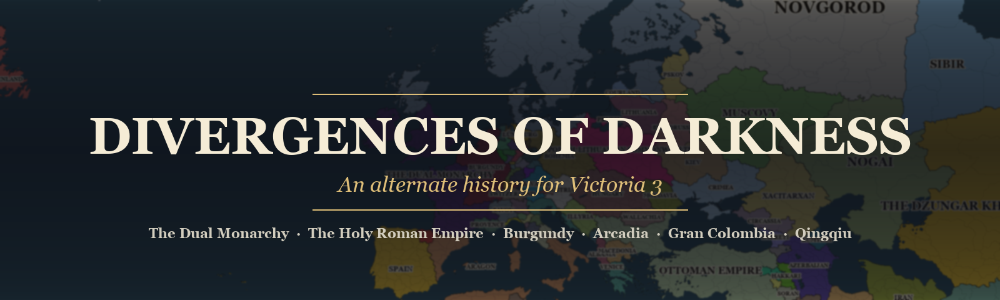
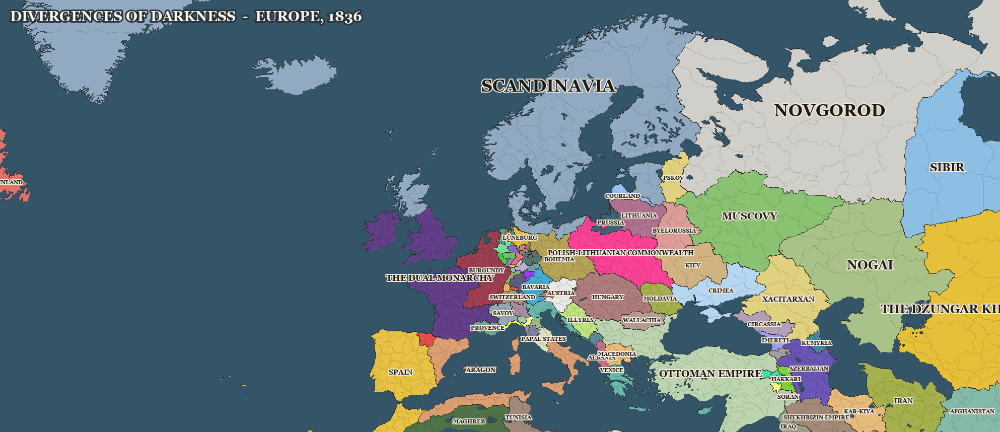
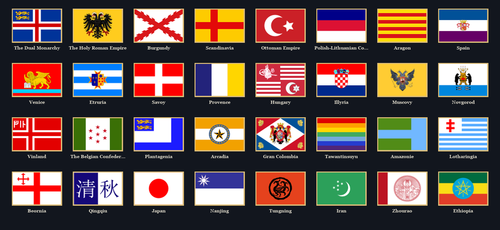
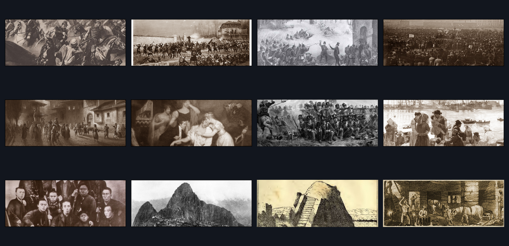

<p align="center">
  
</p>

<p align="center">
  
  
  
  
  
</p>

<p align="center"><i>
"Every decision made in the universe creates an alternative universe.<br>
The first decision that diverged the timeline is called the Point of Divergence."
</i></p>

---

## About

**Divergences of Darkness** is an alternate-history world where four small decisions in the 15th century changed everything:

- **Burgundy kept supporting the Plantagenets** in the Hundred Years' War, and the **Dual Monarchy of England and France** was born.
- **The Kalmar Union survived**, and Denmark, Norway and Sweden grew into a single **Scandinavia**.
- **Isabella of Castile married a Portuguese prince**, uniting Spain and Portugal.
- **The Ming never stopped exploring.** Zheng He's treasure fleets reached Australia and the far side of the Pacific.

By 1836 the world looks nothing like ours. The Plantagenets rule from Paris, a Bohemian Jagiellon is King of the Germans, Burgundy reigns from Antwerp, Chinese republics line the west coast of North America ("Arcadia"), and the Ottoman Empire is tearing itself apart in civil war.

This repository is a **Victoria 3 port** of the Victoria 2 mod. It isn't a line-by-line translation: every storyline has been **rebuilt with Victoria 3's own systems** (journal entries, diplomatic plays, interest groups, laws), keeping the original story, characters and text.

> [!IMPORTANT]
> **Status: pre-alpha, not yet playable.** All the storyline script and the 1836 start (map, pops, economy, armies, wars and characters) now exist, built against the Victoria 3 1.13 game files. The mod has **not been loaded in-game yet**, so expect script errors on the first run. See [Roadmap](#roadmap).

---

## The world in 1836

<p align="center">
  
  <br><sub>Europe at the 1836 start, drawn from the mod's own province map and ownership history.</sub>
</p>

| Power | 1836 |
|---|---|
| **The Dual Monarchy** | The greatest power on Earth, ruled by Henri X from Paris. Only a quarter of its people are Anglois; the English, French, Provencal and Irish resent the merged elite. |
| **The Holy Roman Empire** | Reduced to a "Kingdom of the Germans" after the Great German War. The young Sigismund V dreams of his father's centralised Empire. |
| **Burgundy** | Protestant, rich and industrious, ruling the Low Countries and the Rhine from Antwerp, with colonies at the Cape and in Java. |
| **Scandinavia** | The Kalmar Union, master of Finland, Scotland and Pomerania, pursuing the *Dominium Maris Baltici*. |
| **The Ottoman Empire** | Thirty years into a civil war between Mustafa IV and the reformer Suleiman II, at war with Albania, Macedonia and Egypt. |
| **Arcadia** | Vinland, Plantagenia and the Belgian Confederacy, uneasy neighbours after the War of the Double Alliance. |
| **Gran Colombia** | Spain's former colonies, fighting a renewed Spanish invasion. |
| **Qingqiu & Zhourao** | Chinese republics in North America and Australia, born of Zheng He's voyages. |

---

## What's included

<p align="center">
  
  <br><sub>The flags each country flies in 1836. 2,864 flags were ported from the original mod, including every government variant.</sub>
</p>

| | |
|---|---|
| **593 events** | Storylines, flavour and lore, written for Vic3 |
| **24 journal entries** | The big storylines, each with progress, choices and multiple endings |
| **200 decisions** | Formables, claims, reforms and the national histories |
| **586 countries** | Every DoD country, with colours, tiers, cultures and religions |
| **2,864 flags** | Ported from the original, including republic, communist and fascist variants |
| **33 cultures, 2 religions** | Anglois, Burgundian, Vinlander, Septiman, Beornian, Qingqiuan and more, plus the Taiping and Inti faiths |
| **14 starting rulers** | From Henri X and Sigismund V to Huayna Capac IV and Galdan Khan |
| **280 commanders** | The original mod's starting generals and admirals |
| **649 states, 1.09 billion pops** | The Vic2 1836 map rebuilt on Vic3 states, with split states, homelands and claims |
| **~10,500 building levels** | A starting economy for every country |
| **183 armies, 33 fleets** | Plus starting technology and the nine wars running in 1836 |
| **42,000+ text entries** | English, plus partial French, German and Spanish |
| **84 original event pictures** | Restored from the Vic2 mod |

### Storylines

| | Storyline | Highlights |
|---|---|---|
| 👑 | **The Holy Roman Empire** | The Prague Proclamation, the German princes' choice, the Bohemian Revolution, the Elbian Confederation |
| ⚜️ | **The Dual Monarchy** | The Anglois Dilemma: rule as French, English or both. Succession crises, the Glorious and Midi Revolutions, Ireland and Scotland |
| 🦁 | **Italy, Aragon & Venice** | The Council of Italy, Aragon-Italy, the Valois and Transalpina, the Greek War of Independence, Savoy's succession |
| 🏰 | **Iberia** | The Iberian Union, the Hispanic Commonwealth, the Navarrese succession |
| 🌙 | **The Balkans & the Ottoman fall** | The Ottoman Civil War, Illyria and the Serbs, Yugoslavia, Macedonia, Romania |
| ⚓ | **The Baltic** | Dominium Maris Baltici, the Commonwealth's reform or collapse, Ruthenia |
| 🐻 | **Russia, the Steppe & the Caucasus** | Russian unification, Crimea under Murad II, Circassia, Georgia, Transcaucasia |
| 🕌 | **Persia & Arabia** | The Timurtash Restoration, the Kar-Kiya constitutional revolution, the Arab Revolt, Kurdistan |
| 🗽 | **Arcadia & Ameriga** | The Arcadian Union and Continental Congress, the Slavery Debate, the Cowboy King, Beornia's Communion of Camelot, the Amerigan Federation |
| 🌎 | **Gran Colombia & the Andes** | The Congress of Mexico, the Almasi revolt, the Caste War, the Incas under Pachacuti II |
| 🐉 | **East & South Asia** | The Seoul Treaty, unequal treaties, the Regency War, the Mad Baron, Operation Tsunami |
| 🦓 | **Africa & Oceania** | Burgundy against the Boers, Ethiopia and Adal, Kongo, Dahomey, Polynesia |
| 🏺 | **Archaeology** | Exploration-style excavations at Yucatan, Babylon, Mycenae, Knossos and Troy |
| 📜 | **Histories of the World** | Each great nation can read its own history: 114 pages of the original lore |

Plus world, Europe, Americas and Asia **flavour events** (Nobel Prizes, the Springtime of Nations, the Stone Emperor's statue, the Neuwelt Hansa, the Lanfang kongsi and many more), and **railroading** that sets the 1836 wars in motion.

<p align="center">
  
  <br><sub>Original event art from the Vic2 mod, restored to the matching Vic3 events.</sub>
</p>

---

## Repository layout

```
DoD_Vic3/           The Victoria 3 mod itself
  common/           Journal entries, decisions, modifiers, cultures, religions, history, ...
  events/           All events, one file per storyline
  gfx/              Flags (coats of arms) and event pictures
  localization/     English, French, German, Spanish
  _unverified/      Drafts not loaded by the game (political movements)
tools/              Python scripts that convert and check the mod
start_data/         The Vic2 1836 start (owners, pops, place names) and its link to the Vic3 map
docs/               Port plan, gaps list and lore research notes
images/             Pictures for this page
```

### Tools

| Script | What it does |
|---|---|
| `tools/port_to_vic3.py` | Converts the Vic2 country definitions, flags and localisation |
| `tools/port_event_pictures.py` | Restores the original event pictures, matched by event title |
| `tools/port_translations.py` | Converts the French, German and Spanish text |
| `tools/vic2_start_data.py` | Extracts the 1836 start: province owners, populations by culture and religion, diplomacy |
| `tools/vic3_map_link.py` | Links every Vic3 land province to the Vic2 province on the same ground |
| `tools/vic3_start_setup.py` | Builds states, pops and capitals from that link |
| `tools/vic3_military.py` | Starting technology, armies and fleets |
| `tools/vic3_economy.py` | Starting buildings, rescaled from vanilla's 1836 economy |
| `tools/vic3_characters.py` | Rulers and commanders |
| `tools/audit.py` | Static audit: undefined tags, cultures, variables and scopes, duplicate keys, broken text |

---

## Installation

> [!WARNING]
> The mod is not playable yet; install it only for testing and development.

1. Copy the `DoD_Vic3` folder into your Victoria 3 mod folder:
   - Windows: `Documents\Paradox Interactive\Victoria 3\mod\`
   - macOS: `~/Documents/Paradox Interactive/Victoria 3/mod/`
2. Enable **Divergences of Darkness** in the launcher's playset.

---

## Roadmap

- [x] Country definitions, flags and localisation
- [x] All 15 storylines rebuilt for Vic3
- [x] World, regional and lore flavour; 1836 railroading
- [x] Cultures, religions, starting laws, subjects and rulers
- [x] Vic2 start data extracted (owners, pops, place names)
- [x] **Map layer (first pass):** Vic3 states, populations, capitals, basic buildings and armies, generated from the Vic2 1836 start
- [x] Starting wars (the nine wars running in the Vic2 1836 start)
- [x] Starting economy (vanilla 1836 buildings rescaled to the DoD map and owners)
- [x] Starting technology, mixed armies and navies
- [x] DoD rulers in place of vanilla's, plus 280 generals and admirals from the Vic2 mod
- [ ] First in-game load and bug fixing
- [ ] Political movements (drafted in `_unverified/`)
- [ ] Custom art for events written new for Vic3

---

## Credits

This port stands on the shoulders of the people who built Divergences:

- **Kinniken**, creator of *Divergences: An Alter Vicky Mod*
- **Capitanloco6 / MajorMajor** and everyone who worked on the Victoria 2 *Divergences of Darkness* and its HPM base
- The authors of the [Victoria 2 Divergences fan wiki](https://victoria2divergences.fandom.com/wiki/Victoria_2_Divergences_Wiki), whose lore guided much of this port

The story, characters, flags and original artwork belong to their original authors. This is an independent fan project and is not affiliated with Paradox Interactive.
